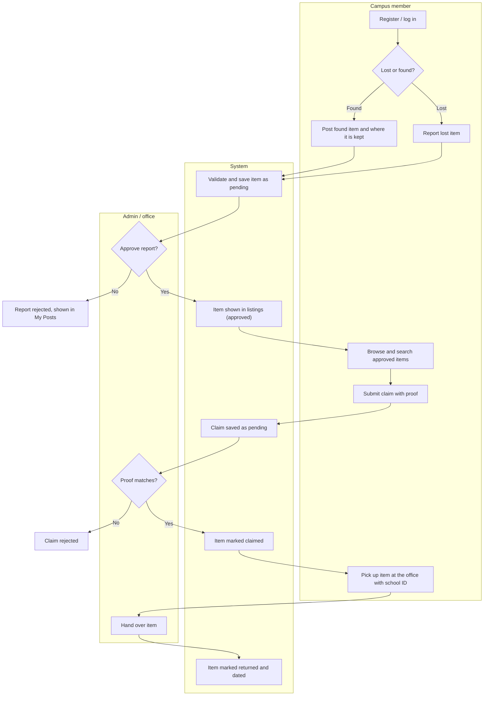
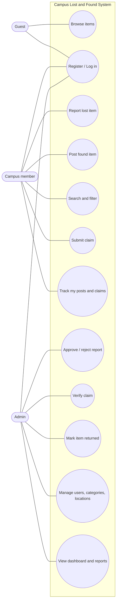
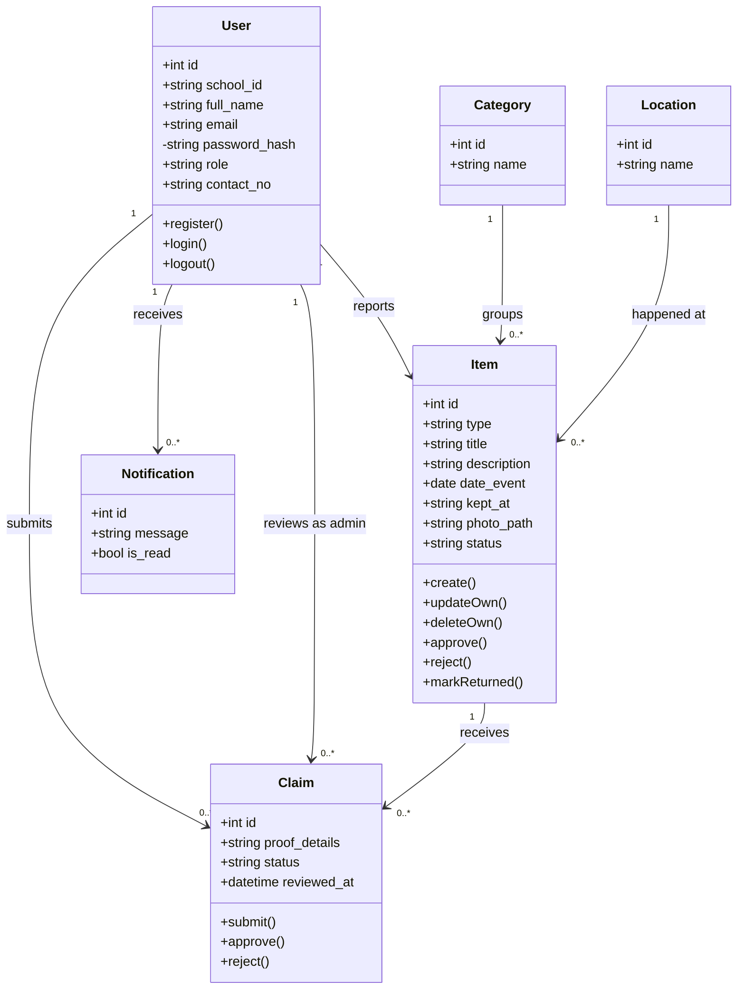
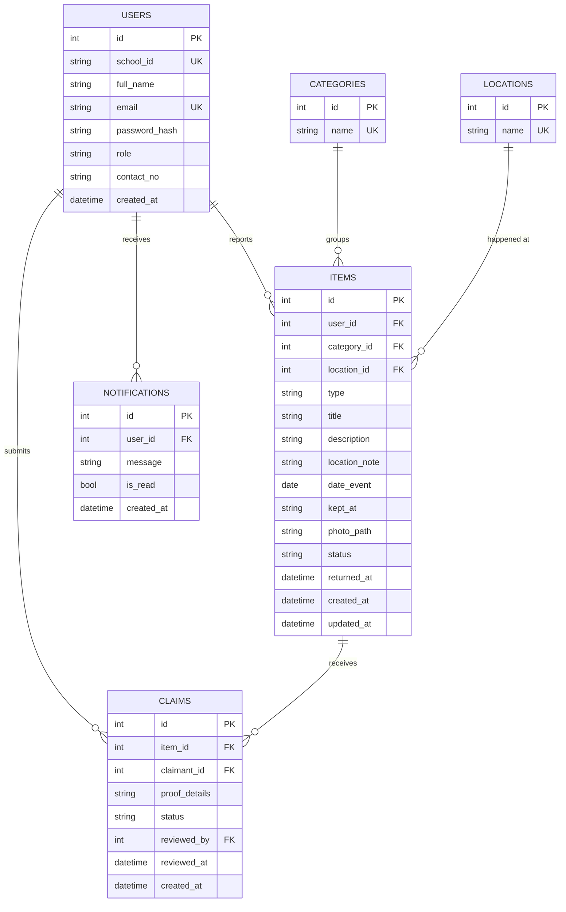
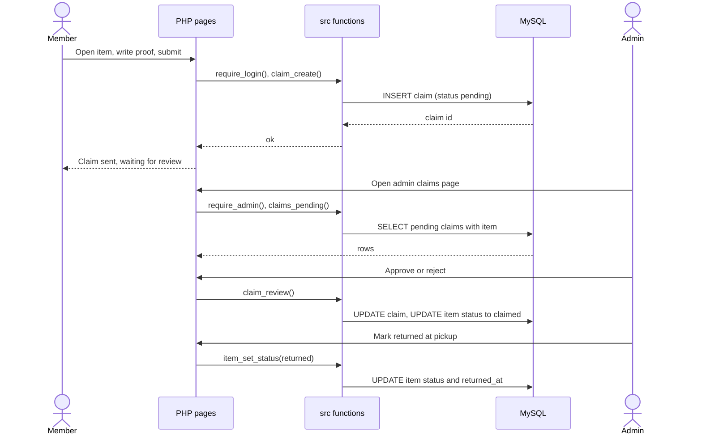
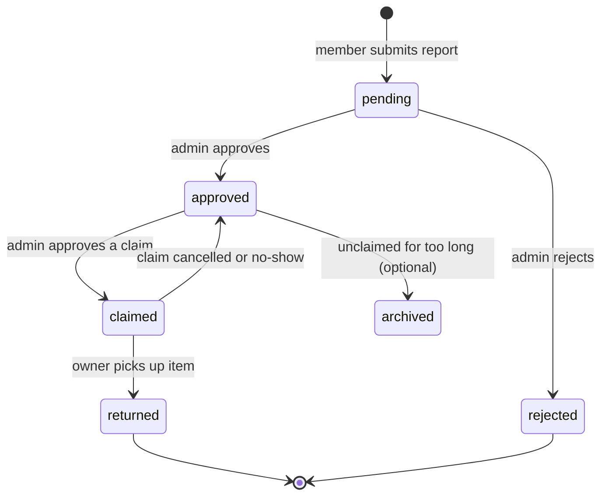
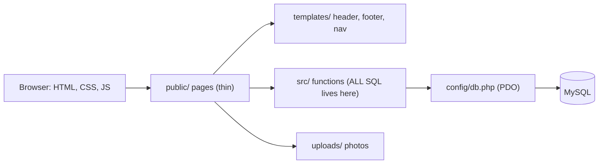

# Campus Lost & Found - Blueprint (single source of truth)

> Every human and every AI tool reads this file BEFORE writing code.
> If the code and this file disagree, the file wins. If you must change something here, change the file FIRST, then the code.
> Diagrams are Mermaid: GitHub renders them automatically. For the paper, paste the code into mermaid.live or redraw in draw.io.

---

## 1. Stack and hard constraints

| Layer | Choice |
|---|---|
| Server | XAMPP / Laragon (Apache + PHP 8.x) |
| Database | MySQL, accessed only through PDO prepared statements |
| Front-end | HTML5, CSS3, vanilla JavaScript (no frameworks) |
| Libraries | None. No Composer packages and no CDN scripts unless both devs agree |
| Charset | utf8mb4 everywhere |

## 2. Roles and permissions

| Action | Guest | Member (student/teacher/staff) | Admin |
|---|---|---|---|
| Browse approved items (private details hidden) | yes | yes | yes |
| See item contact / full details | no | yes | yes |
| Register / log in | yes | - | - |
| Report lost / post found item | no | yes | yes |
| Edit or delete OWN pending posts | no | yes | yes |
| Submit a claim | no | yes (not on own item) | yes |
| Approve or reject reports | no | no | yes |
| Approve or reject claims, mark Returned | no | no | yes |
| Manage users, categories, locations | no | no | yes |

## 3. Status model (exact strings, never invent new ones)

`items.type`   : `lost` | `found`
`items.status` : `pending` | `approved` | `rejected` | `claimed` | `returned` | `archived`
`claims.status`: `pending` | `approved` | `rejected`
`items.kept_at`: `with_finder` | `at_office` (found items only)

`type` (lost or found) and `status` (where it is in the process) are two separate columns. Never mix them.

## 4. Design flow (end to end)



## 5. Use case diagram



## 6. Class diagram



## 7. Entity relationship diagram (matches sql in section 12)



## 8. Sequence diagram: submit and verify a claim



## 9. Item lifecycle (state diagram)



## 10. Architecture (layers - this is what keeps two devs and several AIs compatible)



Layer rules:
1. `public/` pages only: read input -> call `src/` functions -> include a template. No SQL here.
2. `src/` functions only: logic and SQL. They never echo HTML and never redirect. They return arrays.
3. `templates/` only: shared HTML pieces.
4. Pages never call each other's internals; they talk through `src/` function signatures (section 13).

## 11. Folder structure and file ownership

One file = one owner. Only the owner edits it. If you need a change in someone else's file, ask them (or open a PR they review).

```
lostfound/
├── AGENTS.md                      [Both]   rules for any AI tool
├── docs/
│   ├── BLUEPRINT.md               [Both]   this file
│   └── CHANGELOG.md               [Both]   one line per change
├── sql/
│   ├── schema.sql                 [Dev A]  real database structure
│   └── seed.sql                   [Dev A]  sample data
├── config/
│   ├── config.php                 [Dev A]  constants (BASE_URL, upload limits)
│   └── db.php                     [Dev A]  PDO connection: db()
├── src/
│   ├── helpers.php                [Dev A]  e(), redirect(), flash, csrf
│   ├── auth.php                   [Dev A]  login, logout, current_user, require_*
│   ├── users.php                  [Dev A]  register, profile
│   ├── lookups.php                [Dev A]  categories_all(), locations_all()
│   ├── uploads.php                [Dev A]  photo upload and validation
│   ├── items_member.php           [Dev A]  create / edit / delete own items
│   ├── items_public.php           [Dev B]  search, get, recent
│   ├── items_admin.php            [Dev B]  pending list, set status, dashboard counts
│   └── claims.php                 [Dev B]  create, list, review
├── templates/
│   ├── header.php  footer.php  nav.php   [Dev A]
├── public/
│   ├── index.php login.php register.php logout.php      [Dev A]
│   ├── report.php (type=lost|found) my_posts.php         [Dev A]
│   ├── browse.php item.php claim.php my_claims.php       [Dev B]
│   ├── admin/ dashboard.php items.php claims.php         [Dev B]
│   ├── admin/ users.php lookups.php reports.php          [Dev B]
│   └── assets/ css/style.css  js/main.js                 [Dev A: base style, Dev B: own files css/b-*.css js/b-*.js]
└── uploads/                       photos (no PHP execution allowed here)
```

## 12. Database schema (source of truth is sql/schema.sql)

```sql
CREATE TABLE users (
  id INT AUTO_INCREMENT PRIMARY KEY,
  school_id VARCHAR(30) NOT NULL UNIQUE,
  full_name VARCHAR(100) NOT NULL,
  email VARCHAR(120) NOT NULL UNIQUE,
  password_hash VARCHAR(255) NOT NULL,
  role ENUM('student','teacher','staff','admin') NOT NULL DEFAULT 'student',
  contact_no VARCHAR(20) NULL,
  created_at DATETIME NOT NULL DEFAULT CURRENT_TIMESTAMP
) ENGINE=InnoDB DEFAULT CHARSET=utf8mb4;

CREATE TABLE categories (
  id INT AUTO_INCREMENT PRIMARY KEY,
  name VARCHAR(50) NOT NULL UNIQUE
) ENGINE=InnoDB DEFAULT CHARSET=utf8mb4;

CREATE TABLE locations (
  id INT AUTO_INCREMENT PRIMARY KEY,
  name VARCHAR(80) NOT NULL UNIQUE
) ENGINE=InnoDB DEFAULT CHARSET=utf8mb4;

CREATE TABLE items (
  id INT AUTO_INCREMENT PRIMARY KEY,
  user_id INT NOT NULL,
  category_id INT NOT NULL,
  location_id INT NOT NULL,
  type ENUM('lost','found') NOT NULL,
  title VARCHAR(120) NOT NULL,
  description TEXT NOT NULL,
  location_note VARCHAR(150) NULL,
  date_event DATE NOT NULL,
  kept_at ENUM('with_finder','at_office') NULL,
  photo_path VARCHAR(255) NULL,
  status ENUM('pending','approved','rejected','claimed','returned','archived') NOT NULL DEFAULT 'pending',
  returned_at DATETIME NULL,
  created_at DATETIME NOT NULL DEFAULT CURRENT_TIMESTAMP,
  updated_at DATETIME NOT NULL DEFAULT CURRENT_TIMESTAMP ON UPDATE CURRENT_TIMESTAMP,
  FOREIGN KEY (user_id) REFERENCES users(id),
  FOREIGN KEY (category_id) REFERENCES categories(id),
  FOREIGN KEY (location_id) REFERENCES locations(id),
  INDEX idx_status_type (status, type),
  INDEX idx_date (date_event)
) ENGINE=InnoDB DEFAULT CHARSET=utf8mb4;

CREATE TABLE claims (
  id INT AUTO_INCREMENT PRIMARY KEY,
  item_id INT NOT NULL,
  claimant_id INT NOT NULL,
  proof_details TEXT NOT NULL,
  status ENUM('pending','approved','rejected') NOT NULL DEFAULT 'pending',
  reviewed_by INT NULL,
  reviewed_at DATETIME NULL,
  created_at DATETIME NOT NULL DEFAULT CURRENT_TIMESTAMP,
  FOREIGN KEY (item_id) REFERENCES items(id),
  FOREIGN KEY (claimant_id) REFERENCES users(id),
  FOREIGN KEY (reviewed_by) REFERENCES users(id)
) ENGINE=InnoDB DEFAULT CHARSET=utf8mb4;

CREATE TABLE notifications (          -- optional, build last
  id INT AUTO_INCREMENT PRIMARY KEY,
  user_id INT NOT NULL,
  message VARCHAR(255) NOT NULL,
  is_read TINYINT(1) NOT NULL DEFAULT 0,
  created_at DATETIME NOT NULL DEFAULT CURRENT_TIMESTAMP,
  FOREIGN KEY (user_id) REFERENCES users(id)
) ENGINE=InnoDB DEFAULT CHARSET=utf8mb4;
```

## 13. Function contracts (do NOT change a signature; add a new function instead)

Conventions: functions never echo and never redirect. They return plain arrays. On failure they return `['ok' => false, 'errors' => [..]]`.

| File | Function | Returns |
|---|---|---|
| config/db.php | `db(): PDO` | shared PDO connection |
| helpers.php | `e(string $s): string` | HTML-escaped text (use on EVERY output) |
| helpers.php | `redirect(string $path): never` | sends Location header and exits |
| helpers.php | `flash_set(string $type, string $msg): void` / `flash_get(): array` | one-time messages |
| helpers.php | `csrf_field(): string` / `csrf_check(): void` | hidden input / abort on bad token |
| auth.php | `current_user(): ?array` | logged-in user row or null |
| auth.php | `require_login(): void` / `require_admin(): void` | redirect or 403 if not allowed |
| auth.php | `login_user(string $id_or_email, string $password): bool` | true on success |
| auth.php | `logout_user(): void` | destroys session |
| users.php | `register_user(array $data): array` | `['ok'=>bool,'errors'=>[],'id'=>int]` |
| lookups.php | `categories_all(): array` / `locations_all(): array` | rows `[id,name]` |
| uploads.php | `upload_photo(array $file): array` | `['ok'=>bool,'path'=>string,'errors'=>[]]` |
| items_member.php | `item_create(int $user_id, array $data): array` | `['ok','errors','id']`, status always `pending` |
| items_member.php | `items_by_user(int $user_id): array` | all items of that user, newest first |
| items_member.php | `item_update_own(int $item_id, int $user_id, array $data): array` | only while status is pending |
| items_member.php | `item_delete_own(int $item_id, int $user_id): bool` | only while status is pending |
| items_public.php | `items_search(array $filters, int $page = 1, int $per_page = 12): array` | `['rows'=>[],'total'=>int]`, approved only |
| items_public.php | `item_get(int $id): ?array` | one item with category and location names |
| items_public.php | `items_recent(string $type, int $limit = 4): array` | latest approved items of that type |
| claims.php | `claim_create(int $item_id, int $claimant_id, string $proof): array` | `['ok','errors','id']` |
| claims.php | `claims_by_user(int $user_id): array` | the user's claims with item titles |
| claims.php | `claims_pending(): array` | pending claims with item and claimant |
| claims.php | `claim_review(int $claim_id, int $admin_id, string $decision): array` | decision = `approved` or `rejected` |
| items_admin.php | `items_pending(): array` | items waiting for review |
| items_admin.php | `item_set_status(int $id, string $status, int $admin_id): array` | validates the status transition |
| items_admin.php | `dashboard_counts(): array` | counts per status and type |

`items_search` filters (all optional): `q`, `type`, `category_id`, `location_id`, `date_from`, `date_to`.

## 14. Page map

| Page | Who can open | Owner |
|---|---|---|
| index.php | everyone | Dev A |
| login.php, register.php, logout.php | everyone | Dev A |
| browse.php, item.php | everyone (guests see no contact details) | Dev B |
| report.php?type=lost / found | member | Dev A |
| my_posts.php | member | Dev A |
| claim.php, my_claims.php | member | Dev B |
| admin/* | admin only | Dev B |

## 15. Build order and who depends on whom

1. **Day 1, TOGETHER (about 2-3 hours):** sql/schema.sql + seed.sql, config, helpers, auth stubs, templates, base CSS. Commit to main. After this the structure is frozen.
2. **Then split.** Dev B does not wait for Dev A: Dev B codes against the signatures in section 13 and the seed data. Dev A first pushes working `auth.php` + `lookups.php` so Dev B can log in.
3. Merge to main at least once a day. After every merge, both pull and click through the main flow.
4. Last 2 days: no new features. Testing, bug fixes, screenshots for the paper.
